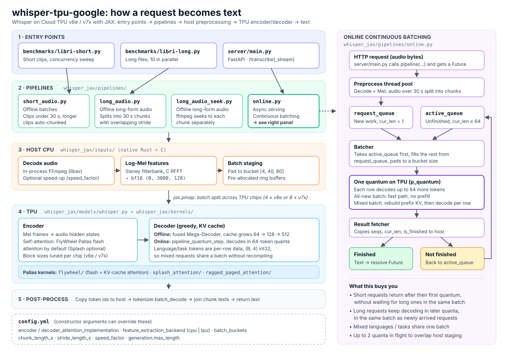

# Whisper JAX for Google Cloud TPU (v6e & v7x)

This implementation is based on the original [sanchit-gandhi/whisper-jax](https://github.com/sanchit-gandhi/whisper-jax) repository, optimized for **Google Cloud TPU v6e and v7x** with custom Pallas Flash Attention kernels, a fused multi-stage XLA Mega-Decoder, continuous batching for online serving, and configurable CPU/TPU Mel-spectrogram preprocessing.

For additional background on the original implementation, see:
https://medium.com/@engineerbharath/unlocking-supersonic-speech-recognition-a-deep-dive-into-optimizing-whisper-on-tpus-6b8d734993d9



See [ARCHITECTURE.md](ARCHITECTURE.md) for a walkthrough of the diagram.

---

## Supported Models

All OpenAI Whisper model sizes (both English-only `.en` and Multilingual variants) are supported across all attention kernels (`flywheel`, `splash`, `original`, `rpa`) and feature extraction backends (`cpu`, `tpu`):

| Size | Parameters | Layers (Enc / Dec) | Heads (Enc / Dec) | `head_dim` | Mel Bins | English-only | Multilingual |
| :--- | :---: | :---: | :---: | :---: | :---: | :---: | :---: |
| **tiny** | 39 M | 4 / 4 | 6 / 6 | 64 | 80 | [✓ (`openai/whisper-tiny.en`)](https://huggingface.co/openai/whisper-tiny.en) | [✓ (`openai/whisper-tiny`)](https://huggingface.co/openai/whisper-tiny) |
| **base** | 74 M | 6 / 6 | 8 / 8 | 64 | 80 | [✓ (`openai/whisper-base.en`)](https://huggingface.co/openai/whisper-base.en) | [✓ (`openai/whisper-base`)](https://huggingface.co/openai/whisper-base) |
| **small** | 244 M | 12 / 12 | 12 / 12 | 64 | 80 | [✓ (`openai/whisper-small.en`)](https://huggingface.co/openai/whisper-small.en) | [✓ (`openai/whisper-small`)](https://huggingface.co/openai/whisper-small) |
| **medium** | 769 M | 24 / 24 | 16 / 16 | 64 | 80 | [✓ (`openai/whisper-medium.en`)](https://huggingface.co/openai/whisper-medium.en) | [✓ (`openai/whisper-medium`)](https://huggingface.co/openai/whisper-medium) |
| **large** | 1550 M | 32 / 32 | 20 / 20 | 64 | 80 | ✗ | [✓ (`openai/whisper-large`)](https://huggingface.co/openai/whisper-large) |
| **large-v2** | 1550 M | 32 / 32 | 20 / 20 | 64 | 80 | ✗ | [✓ (`openai/whisper-large-v2`)](https://huggingface.co/openai/whisper-large-v2) |
| **large-v3** | 1550 M | 32 / 32 | 20 / 20 | 64 | 128 | ✗ | [✓ (`openai/whisper-large-v3`)](https://huggingface.co/openai/whisper-large-v3) |
| **large-v3-turbo** | 809 M | 32 / 4 | 20 / 20 | 64 | 128 | ✗ | [✓ (`openai/whisper-large-v3-turbo`)](https://huggingface.co/openai/whisper-large-v3-turbo) |

* *Note:* For checkpoints without native Flax weights (such as `openai/whisper-large-v3-turbo`), PyTorch weights are automatically converted to Flax on initialization.

---

## Repository Structure

The package follows a modular layout under `whisper_jax/`:

```text
whisper_jax/
├── distributed/   # Partitioning and inference state utilities (partitioner.py, train_state.py)
├── inputs/        # Native Rust/C audio loader, FFmpeg decoding, and Mel filterbank extraction (audio_loader.py, rust_audio/)
├── kernels/       # Custom TPU Pallas kernels (FlyWheel Flash Attention, Tokamax Splash & RPA wrappers)
├── layers/        # Neural network building blocks (norms.py)
├── models/        # Whisper configuration, Flax encoder/decoder & fused multi-stage Mega-Decoder (configuration_whisper.py, whisper.py)
└── pipelines/     # End-to-end pipelines (short_audio.py, long_audio.py, long_audio_seek.py, online.py)
```

Top-level module paths (`whisper_jax.pipeline`, `whisper_jax.pipeline_long_audio`, `whisper_jax.pipeline_online`, `whisper_jax.modeling_flax_whisper`) are re-exported for backward compatibility.

---

## Pipeline Architectures

### 1. Standard Batch Pipeline (`whisper_jax/pipelines/short_audio.py`)
* **Use Case:** Offline batch transcription of short audio clips (<30s), with automatic multi-chunk handling for longer clips.
* **Logic:** Data-parallel (`jax.pmap`) execution with bucketed batch padding and persistent ring-buffer staging.
* **Entrypoint:** `benchmarks/libri-short.py`.

### 2. Long Audio Pipeline (`whisper_jax/pipelines/long_audio.py`)
* **Use Case:** Offline transcription of long-form audio files.
* **Logic:** Splits long audio into overlapping 30s chunks (`chunk_length_s`, `stride_length_s`), dispatches batches across TPU cores, and merges chunk transcriptions.
* **Entrypoint:** `benchmarks/libri-long.py`.

### 3. Online Serving Pipeline (`whisper_jax/pipelines/online.py`)
* **Use Case:** Production HTTP API serving (FastAPI).
* **Logic:** Asynchronous request handling with continuous batching (`batch_buckets: [4, 40, 80]`), early-exit resolution for short requests, co-batching of continuing and newly arrived requests, dynamic per-request language/task batching without XLA recompilation, and automatic multi-chunk handling for long audio.
* **Entrypoint:** `server/main.py` and `benchmarks/test_api_smart.py`.

---

## Kernel & Backend Configuration (`config.yml`)

All pipelines read their runtime settings from `config.yml` (and accept overrides via constructor arguments):

```yaml
common:
  dtype: "bfloat16"

  # Encoder self-attention implementation:
  # - "flywheel": FlyWheel Pallas token-major Flash Attention with paired d=64 head DMAs (default)
  # - "splash":   Tokamax Pallas Splash Attention
  # - "original": Standard XLA dot-product attention
  encoder_attention_implementation: "flywheel"

  # Decoder attention implementation:
  # - "original" (or "mega"): Fused XLA nested 3-stage (64 -> 128 -> 512) KV-cache Mega-Decoder (default)
  # - "flywheel":             FlyWheel Pallas contiguous KV-cache decode attention
  # - "flywheel_paged":       FlyWheel Pallas paged KV-cache decode attention
  # - "rpa":                  Tokamax Ragged Paged Attention v3
  decoder_attention_implementation: "original"

  # Mel-spectrogram feature extraction backend:
  # - "cpu": Native C/Rust FFmpeg + Slaney Mel filterbank on host CPU, transferring bfloat16 (B, 3000, 128) features (default)
  # - "tpu": Raw float32 waveform transfer to TPU with in-graph STFT + Mel extraction
  feature_extraction_backend: "cpu"
```

Hardware-specific Pallas tile sizes (`block_q`, `block_kv`) are selected automatically at runtime based on the detected TPU device kind (`TPU v6e` vs `TPU v7x`).

---

## 1. Infrastructure Setup (Local Machine)

Run these commands from your local machine to provision a Cloud TPU VM.

### 1.1 Set Environment Variables

```bash
export TPU_NAME=TPU-testing
export PROJECT_ID=tpu-launchpad-playground
export REGION=us-central1
export ZONE=us-central1-b
```

### 1.2 Create TPU VM

```bash
gcloud alpha compute tpus tpu-vm create $TPU_NAME \
  --type v6e --topology 2x4 \
  --project $PROJECT_ID --zone $ZONE \
  --version v2-alpha-tpuv6e --tags=allow-iap-ssh
```

### 1.3 Configure Firewall for IAP SSH (Optional)

```bash
gcloud compute firewall-rules create allow-iap-on-tagged-vms-high-priority \
  --project=$PROJECT_ID \
  --description="High-priority allow for IAP on tagged VMs" \
  --direction=INGRESS \
  --priority=900 \
  --network=default \
  --action=ALLOW \
  --rules=tcp:22 \
  --source-ranges=35.235.240.0/20 \
  --target-tags=allow-iap-ssh
```

### 1.4 SSH into the TPU VM

```bash
gcloud alpha compute tpus tpu-vm ssh --zone $ZONE $TPU_NAME --project $PROJECT_ID --tunnel-through-iap
```

---

## 2. Software Installation (Inside TPU VM)

### 2.1 Install System Dependencies

```bash
sudo apt-get update && sudo apt-get install -y git ffmpeg
sudo sh -c "echo always > /sys/kernel/mm/transparent_hugepage/enabled"

pip install tpu-info
export PATH="$HOME/.local/bin:$PATH"
tpu-info
```

### 2.2 Clone the Repository

```bash
git clone https://github.com/hks-9697-v2/whisper-tpu-google.git
cd whisper-tpu-google
```

### 2.3 Install Python Dependencies

```bash
# 1. Install JAX for TPU
pip install -U "jax[tpu]" -f https://storage.googleapis.com/jax-releases/libtpu_releases.html

# 2. Upgrade pip and install the package in editable mode
python3 -m pip install --upgrade pip
pip install -e .
```

---

## 3. Running the Benchmarks

### 3.1 Configure Audio Speed-Up (Optional)

In `config.yml`, `common.speed_factor` controls optional FFmpeg `atempo` audio speed-up prior to transcription:

```yaml
common:
  speed_factor: 1.0  # Set to 1.0 for original audio speed, or e.g. 2.2 for sped-up audio
```

### 3.2 Short Audio Benchmark (`benchmarks/libri-short.py`)

Use `benchmarks/libri-short.py` for short audio clips (<30 seconds). Pass `--model_id` to select any supported Whisper checkpoint:

```bash
# Run with default model (openai/whisper-large-v3)
python3 benchmarks/libri-short.py

# Run with openai/whisper-large-v3-turbo
python3 benchmarks/libri-short.py --model_id "openai/whisper-large-v3-turbo"

# Run with English-only or smaller multilingual models
python3 benchmarks/libri-short.py --model_id "openai/whisper-base.en"
python3 benchmarks/libri-short.py --model_id "openai/whisper-small"
python3 benchmarks/libri-short.py --model_id "openai/whisper-medium"
python3 benchmarks/libri-short.py --model_id "openai/whisper-large-v2"
```

### 3.3 Long Audio Benchmark (`benchmarks/libri-long.py`)

Use `benchmarks/libri-long.py` for long-form chunked audio transcription:

```bash
# Run with default model (openai/whisper-large-v3)
python3 benchmarks/libri-long.py

# Run with openai/whisper-large-v3-turbo
python3 benchmarks/libri-long.py --model_id "openai/whisper-large-v3-turbo"

# Run with other supported Whisper checkpoints
python3 benchmarks/libri-long.py --model_id "openai/whisper-medium.en"
python3 benchmarks/libri-long.py --model_id "openai/whisper-large-v2"
```

### 3.4 Online Server Benchmark

1. **Start the FastAPI Server:**
   ```bash
   cd server/
   python3 -m uvicorn main:app --host 0.0.0.0 --port 8000
   ```
   Wait until the server completes warmup and logs `Application startup complete`.

2. **Run the Benchmark Client:**
   ```bash
   python3 benchmarks/test_api_smart.py -n 1280 -c 1280
   ```
   * `-n`: Total number of requests.
   * `-c`: Concurrency level (simultaneous client workers).
